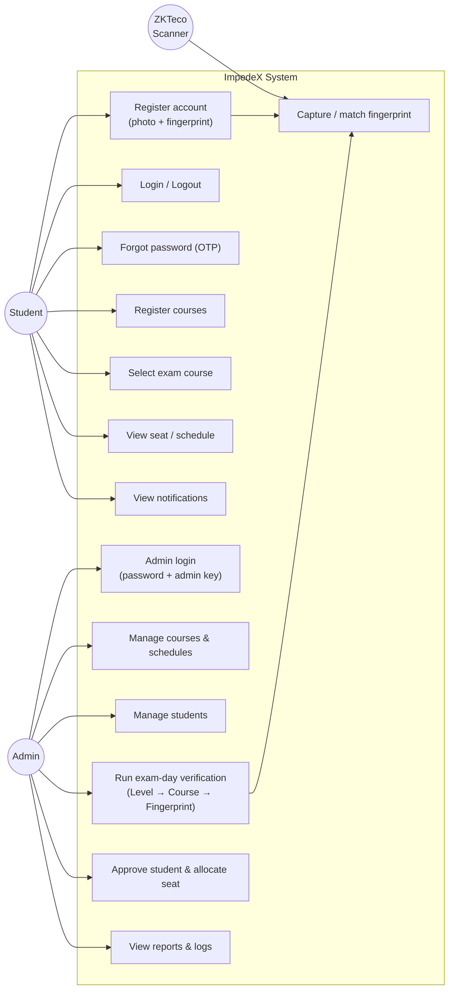
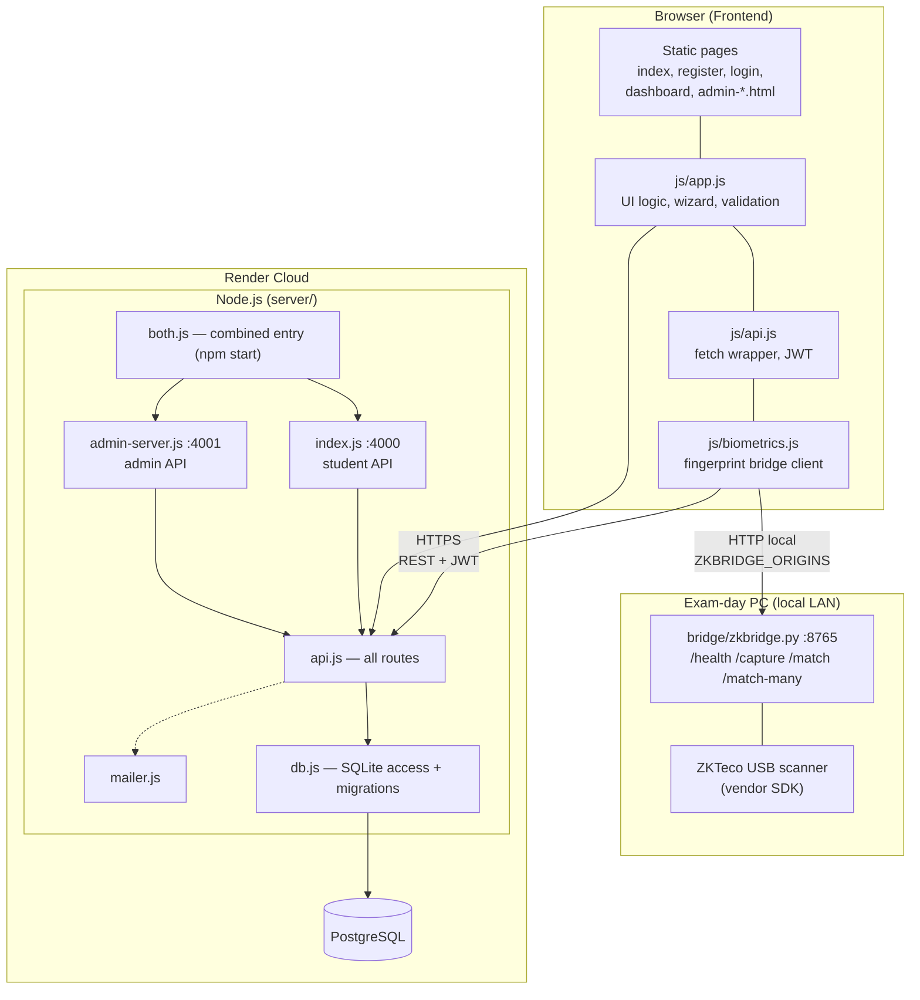
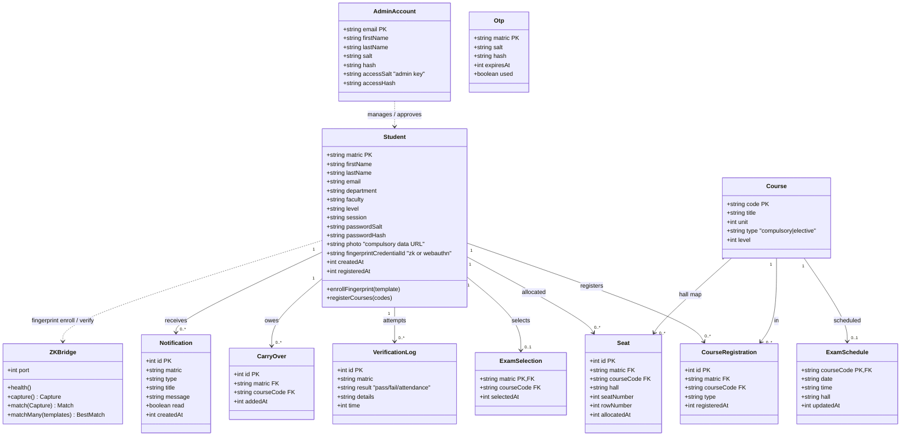
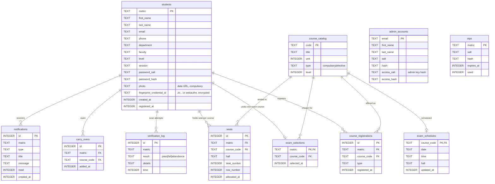
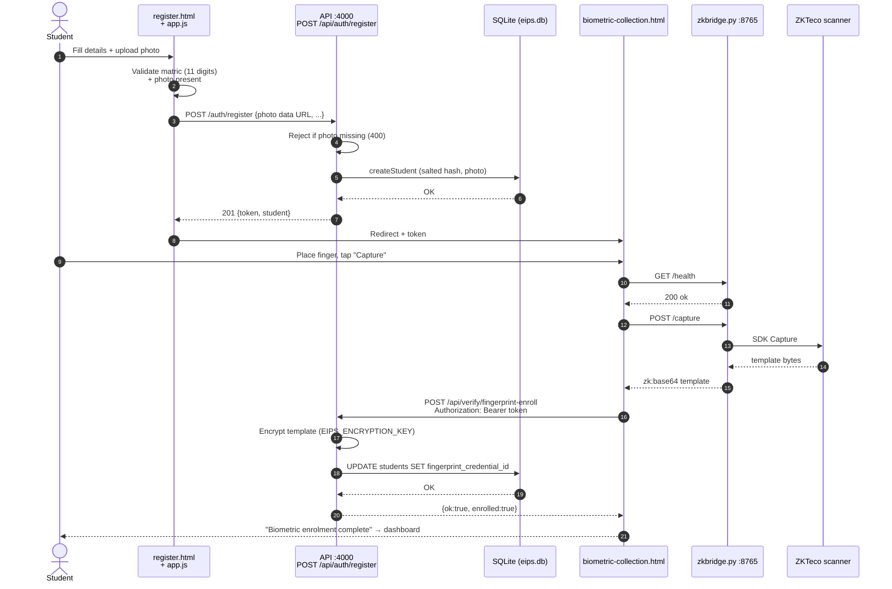
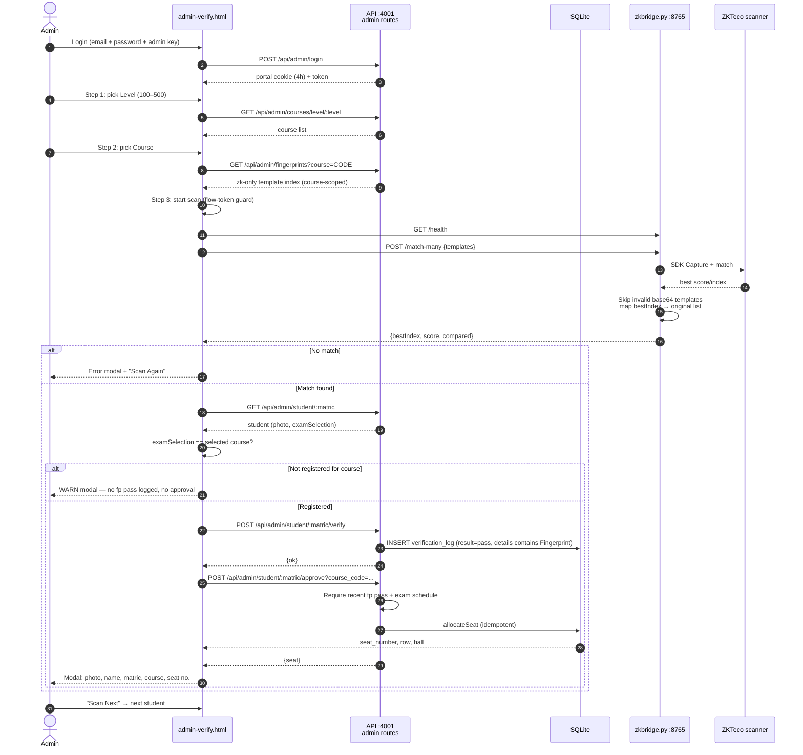
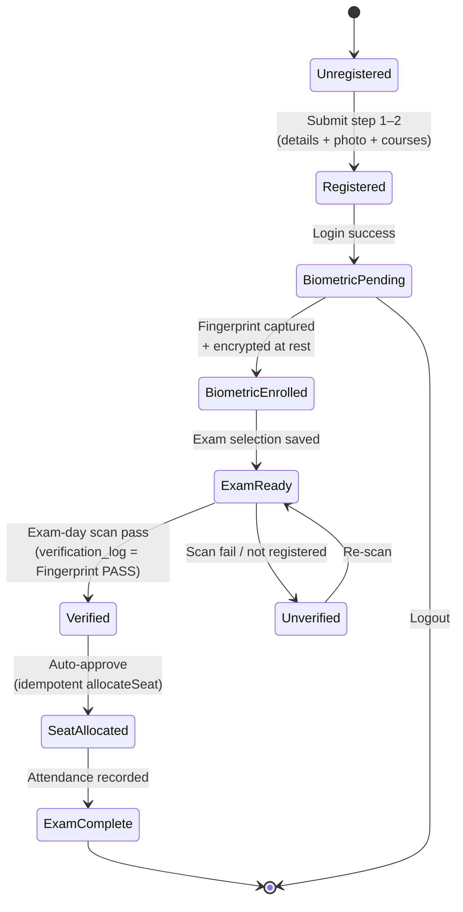
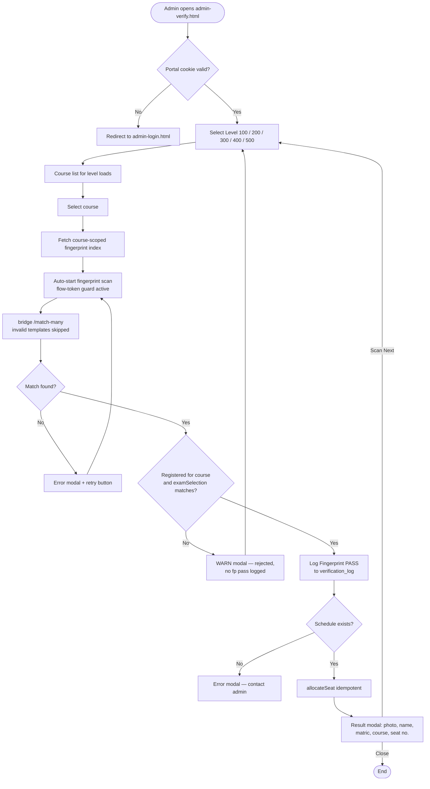
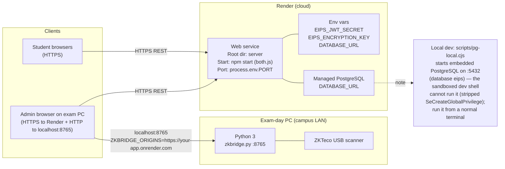

# ImpedeX (EIPS) — UML Diagrams

Mermaid UML for the **Electronic Exam Identity & Proctoring System (ImpedeX)**.
View on GitHub/GitLab or any Mermaid-enabled editor.

---

## 1. Use Case Diagram

---

## 2. Component / Architecture Diagram

---

## 3. Class Diagram (Domain Model)

---

## 4. Entity–Relationship Diagram (SQLite schema)

---

## 5. Sequence Diagram — Student Registration & Biometric Enrolment

---

## 6. Sequence Diagram — Exam-Day Verification (critical path)

---

## 7. State Diagram — Student Lifecycle

---

## 8. Activity Diagram — Exam-Day Wizard Flow

---

## 9. Deployment Diagram

---

*Generated for ImpedeX v1 — facial recognition intentionally out of scope (removed); fingerprint-only biometrics.*
